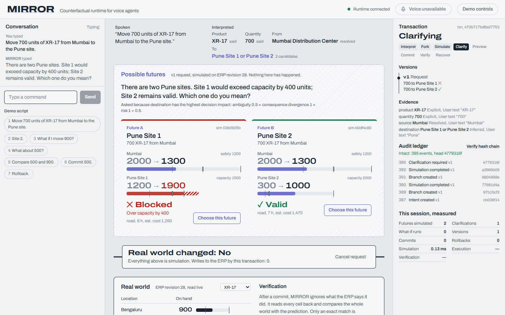
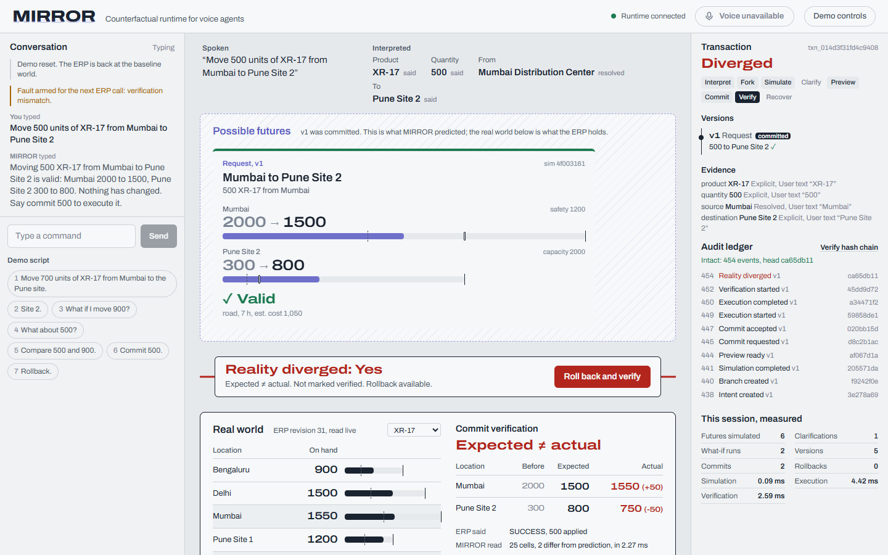
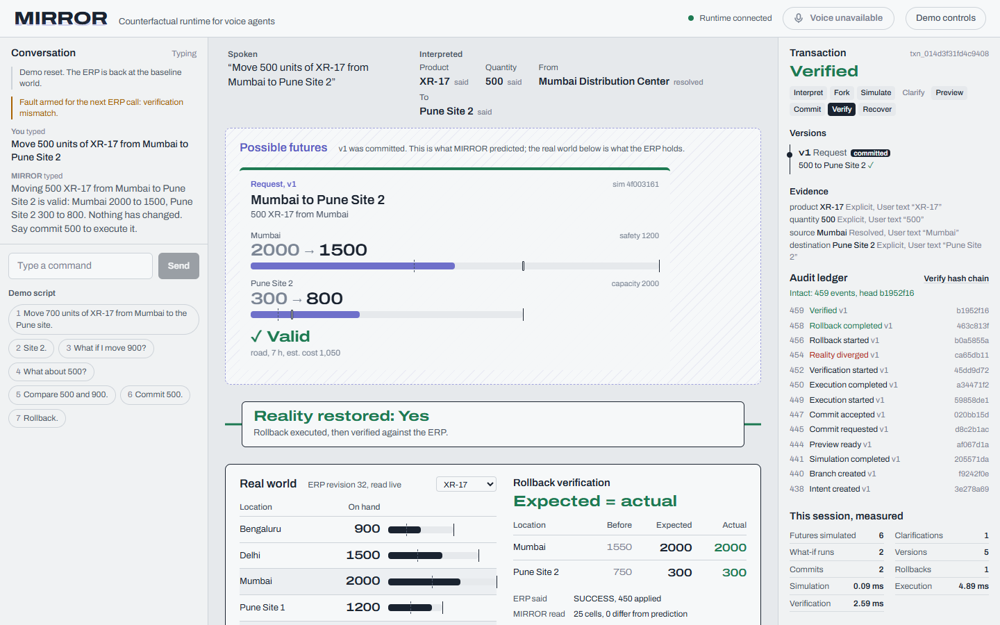
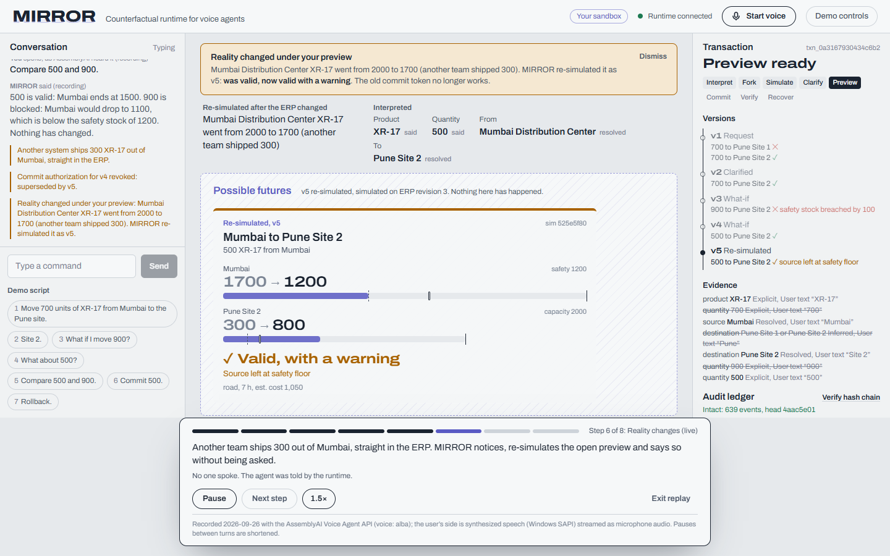
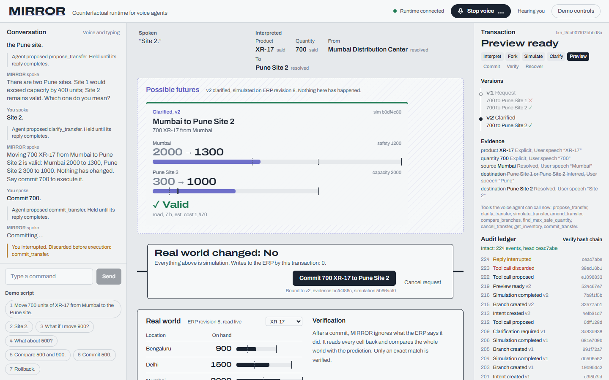

# MIRROR

> **Before a voice command changes reality, see what it could do.**

```text
Voice agents normally jump from language to action.

MIRROR inserts a shadow world between them.
```

```text
SPEAK → FORK → SIMULATE → COMPARE → COMMIT → VERIFY
```



"Move 700 units of XR-17 from Mumbai to the Pune site." There are two Pune sites, so MIRROR does not guess and does not just ask "which one?". It simulates both: Site 1 would exceed capacity by 400, Site 2 stays valid. Then it asks the question whose answer actually changes the outcome. Nothing has touched the ERP yet.

**Try it:** the app opens on a start page with three ways in. *Watch the 2½-minute replay* plays a recorded live AssemblyAI session while this server recomputes every future, check and number on screen. *Talk to it* starts a voice session in your browser. *Open the console* lets you type. On the public demo, every visitor gets a private sandbox copy of the ERP.

## What it does

- **Forks** one utterance into every interpretation the ERP's own data allows, and simulates each one against a read-only snapshot.
- **Explains** why the futures differ, with real numbers (before, after, threshold).
- **Clarifies** by consequence, choosing the question by `ambiguity × consequence divergence × risk`.
- **Explores** what-ifs ("what if I move 900?"), comparisons ("compare 500 and 900") and the maximum safe quantity, all without changing reality.
- **Commits** only on an explicit instruction from the user, bound by an HMAC token to one version, one evidence set and one simulation. Corrections create new versions and revoke older authorizations.
- **Verifies** by reading the whole world back. If the ERP says "success" but moved 450 instead of 500, MIRROR shows **Reality diverged** and never calls it verified.
- **Rolls back** from what actually happened, then verifies the restoration.
- **Watches reality.** If the ERP changes under an open preview (another system, or another user's commit), MIRROR re-simulates it, revokes the old commit token, and the agent says so without being asked.
- **Understands free-form typing** through AssemblyAI's LLM Gateway, as proposals that still have to be backed by your own words.
- **Records** every step in an append-only, SHA-256 hash-chained ledger.

| Diverged: the ERP claimed success | Restored and verified |
| --- | --- |
|  |  |



## Where AssemblyAI fits

MIRROR's conversational layer is the [AssemblyAI Voice Agent API](https://www.assemblyai.com/docs/voice-agents/voice-agent-api) over one WebSocket (`wss://agents.assemblyai.com/v1/ws`): speech recognition, turn detection, barge-in, tool calling, spoken replies and domain keyterms. The backend relays audio so the API key never reaches the browser, and it treats AssemblyAI's pieces as follows:

- `transcript.user.delta` updates the live line (overwritten, never concatenated); `transcript.user` becomes **evidence**, the only source that can make a value explicit.
- `tool.call` is a **proposal**. MIRROR holds it until the reply that contains it finishes. If the user barges in (`reply.done` with `status: "interrupted"`), agent audio is flushed and pending calls are discarded before they ever reach the runtime, so an interrupted "commit" cannot execute.
- Tool arguments are checked against the transcript: if the user said "the Pune site", both sites are simulated even if the model picked one.
- The tool list changes with the transaction state (progressive tool reveal): `commit_transfer` exists only while a valid preview does. Keyterms narrow to the options being asked about.
- When reality moves under a preview, the backend asks the agent to speak with `reply.create`, and waits for `reply.done` if the agent is mid-sentence, so it never talks over itself.
- A dropped connection first tries `session.resume`. The live service currently refuses it (`session_not_found`), so MIRROR opens one fresh session and restores the open transaction as context: the transaction lives in MIRROR, not in the voice session.
- Typed text the deterministic compiler cannot classify goes to the [LLM Gateway](https://www.assemblyai.com/docs/llm-gateway) (same key, server-side). Its JSON answer is mapped onto the voice agent's proposal tools, so the evidence gate applies unchanged: live, the model read "yep sounds right to me" as `commit`, and the backend refused.



## Run it

Requirements: Python 3.11+, Node 20+.

```bash
# 1. backend
cd backend
python -m venv .venv
.venv/Scripts/pip install -r requirements-dev.txt     # macOS/Linux: .venv/bin/pip

# 2. frontend (built once, then served by the backend)
cd ../apps/web
npm install
npm run build
cd ../..

# 3. configuration
cp .env.example .env     # ASSEMBLYAI_API_KEY enables voice; MIRROR_COMMIT_SECRET makes tokens durable

# 4. start
cd backend
.venv/Scripts/python -m uvicorn app.main:create_app --factory --port 8000
```

Open <http://127.0.0.1:8000>. Without an AssemblyAI key, voice is disabled and the command box and the replay drive the identical runtime.

For UI development, run the backend as above and `npm run dev` in `apps/web` (port 5173, proxied to the backend). With Docker: `docker compose up --build`.

**Public demo:** [](https://render.com/deploy?repo=https://github.com/Unknown1502/MIRROR) `render.yaml` deploys it to Render's free tier with per-visitor sandboxes, voice time caps, rate limits and the AssemblyAI key as a secret. Hugging Face Spaces also works (`scripts/deploy_hf_space.py`, needs PRO). See [docs/deploy.md](docs/deploy.md).

## Demo

Reset (Demo controls → Reset to baseline world), then say or type:

1. "Move 700 units of XR-17 from Mumbai to the Pune site." Two futures; Site 1 blocked by capacity, Site 2 valid.
2. "Site 2."
3. "What if I move 900?" Mumbai would drop 100 below safety stock. Nothing has changed.
4. "What about 500?"
5. "Compare 500 and 900."
6. "Commit 500." Reality verified: Mumbai 1500, Pune Site 2 800.
7. Reset, arm **Short shipment**, repeat with 500, commit: Reality diverged (1550 / 750).
8. "Rollback." Reality restored, verified.

The full timed script, optional beats and stage recovery steps are in [docs/demo.md](docs/demo.md).

## Evidence that it works

| Check | Result |
| --- | --- |
| Backend tests (`cd backend && .venv/Scripts/python -m pytest -q`) | 116 passed |
| Adversarial run against a live server (`scripts/fuzz_api.py`): 69 hostile turns, 21 malformed or unauthorized calls, 12 racing commits | no 500s, no unrequested ERP change, one execution |
| Browser E2E, typed path, in Chromium, Firefox and WebKit (Safari's engine) | PASS |
| Browser E2E, start page + replay + second-visitor isolation, in Chromium, Firefox and WebKit, and against the Docker image | PASS |
| **Live AssemblyAI** suite: 39 spoken turns, 31 real tool calls (`scripts/live_voice_test.py`) | **53/53 PASS** |
| **Live AssemblyAI** after the reality watch: honesty + adversarial, spoken reality alert | **28/28 PASS** |
| **Live AssemblyAI** judge session (the replay) | **8/8 PASS** |
| **Live LLM Gateway**: six free-form phrasings | **6/6 PASS** |
| **Live browser**: start page → Talk to it, WAV-fed mic, real AssemblyAI, spoken commit changes the ERP | **13/13 PASS** |
| Browser E2E, voice path against a protocol stand-in | 8/8 checks PASS |
| Smoke test against a running server | 11/11 PASS; commit + execution + full verification in about 60 ms |
| Benchmark, 26 scenarios vs a naive voice→action agent | final state correct 26 vs 10; unsafe actions 0 vs 9; wrong interpretations executed 0 vs 6 |

Details: [docs/testing.md](docs/testing.md), [docs/benchmark.md](docs/benchmark.md). What is live, mocked or unverified: [docs/status.md](docs/status.md), including the defects live testing found and how they were fixed. Median latency from the end of the user's speech to the agent's first audio is 3.3 s when a tool runs and 1.9 s when none does.

## Documentation

- [Architecture](docs/architecture.md): components, lifecycle, commit gate, voice sequence
- [API](docs/api.md): endpoints, event contract, error codes
- [Demo](docs/demo.md): script and pitch
- [Testing](docs/testing.md)
- [Threat model](docs/threat-model.md)
- [Benchmark](docs/benchmark.md)
- [Status](docs/status.md)
- [Deploy](docs/deploy.md): Hugging Face Spaces, public-demo guardrails
- [Human voices](docs/human-voice.md): re-run every live check with recorded people

## Beyond inventory

Inventory is the proof domain. The runtime's contract is `action + current state + simulator + consequences + commit + verifier`; the ERP adapter is the only inventory-specific part. The same loop fits shipping, procurement, IAM changes, cloud operations or scheduling.

## License

MIT
