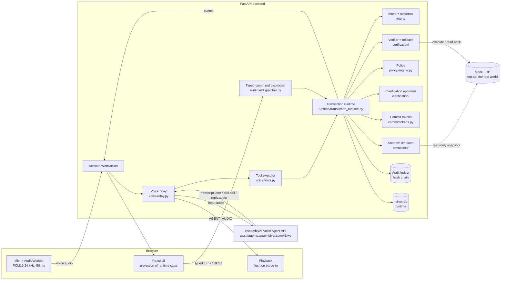
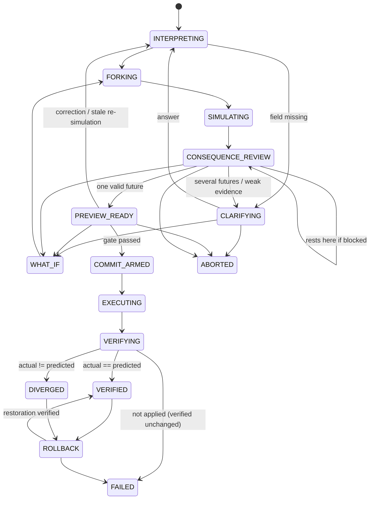
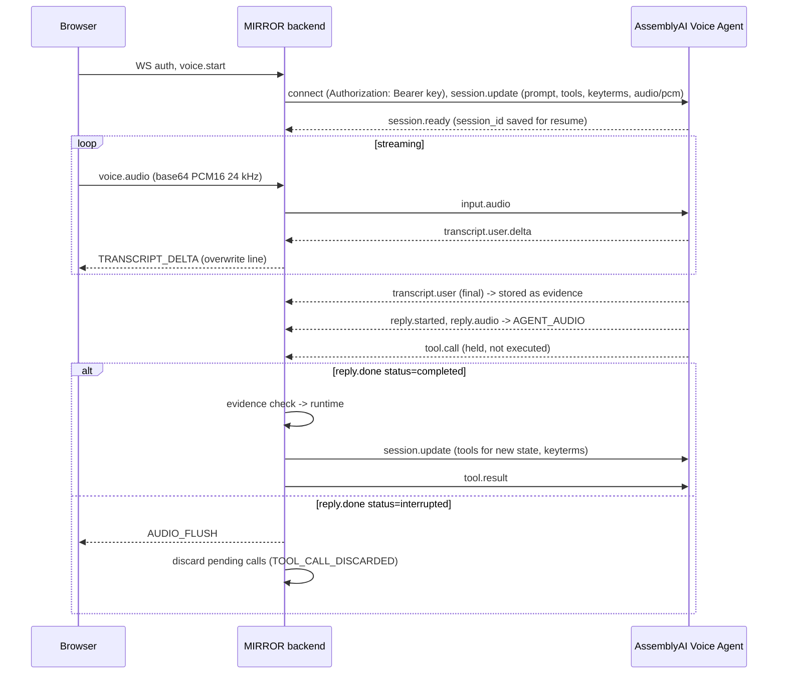
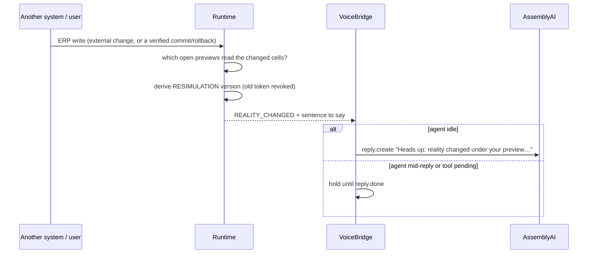

# Architecture

MIRROR inserts a shadow execution layer between a voice agent's interpretation of speech and any real-world side effect. This document describes what is actually implemented.

## Core invariant

```text
The model may propose.     -> AssemblyAI Voice Agent emits tool.call (a proposal)
The runtime decides.       -> evidence check + deterministic entity resolution + state machine
The simulator predicts.    -> pure function of an immutable ERP snapshot
The user commits.          -> explicit user language (voice/typed) or an authenticated click, bound to a version
The backend executes.      -> ERP operation with idempotency key and compare-and-swap preconditions
The verifier decides.      -> full-world read-back compared with the prediction
```

The invariant is written at the top of [backend/app/__init__.py](../backend/app/__init__.py).

## Components



| Layer | Module | Responsibility |
| --- | --- | --- |
| Voice | `voice/relay.py`, `voice/agent_config.py` | Server-side relay to AssemblyAI; tool-call gating; interruption handling; session resume; progressive tool reveal; dynamic keyterms |
| Intent | `intent/entities.py`, `intent/compiler.py`, `intent/evidence.py`, `intent/numbers.py` | Entity resolution against ERP data; deterministic utterance compiler; evidence statuses; checking model-proposed values against transcripts |
| Runtime | `runtime/transaction_runtime.py` | Versions, forking, state machine, commit gate, execution, verification, rollback, audit |
| Simulation | `simulation/simulator.py`, `simulation/optimizer.py` | Pure consequence calculation; exhaustive max-safe-quantity search |
| Policy | `policy/engine.py` | Which consequences block; evidence eligibility; single-interpretation rule |
| Clarification | `clarification/optimizer.py` | `ambiguity x consequence_divergence x risk_weight`; consequence-aware question text |
| Commit | `commit/tokens.py` | HMAC token over `(transaction_id, version, evidence_hash, simulation_hash)` |
| Verification | `verification/verifier.py`, `verification/rollback.py` | Full-world diff; compensation planned from the *actual* post-state |
| ERP adapter | `erp/service.py`, `erp/seed.py` | Separate database; idempotent operations; CAS preconditions; deterministic one-shot faults |
| Audit | `audit/ledger.py` | Append-only SHA-256 hash chain; `verify_chain()` |
| API | `api/routes.py`, `api/ws.py`, `main.py` | REST contract, session WebSocket, error contract, auth, CSP, static UI |
| Frontend | `apps/web/src` | Zustand store fed by runtime events; renders backend state only |

## Two databases, on purpose

- `data/erp.db` is the mock ERP: products, locations, inventory, routes, an operation log and fault state. It stands for the external system whose state is reality.
- `data/mirror.db` is MIRROR's runtime: sessions, transcripts, transactions, immutable versions, evidence, branches, simulation runs, consequences, executions and the audit ledger.

The runtime never writes inventory rows. It asks the ERP to run `TRANSFER_INVENTORY` or `ADJUST_INVENTORY`, then reads the world back. The simulator receives a frozen `WorldSnapshot` (`MappingProxyType` over frozen dataclasses) and has no ERP handle.

History tables (`transaction_versions`, `evidence`, `branches`, `simulation_runs`, `consequences`, `transcript_items`, `audit_events`) have SQLite `BEFORE UPDATE` / `BEFORE DELETE` triggers that abort, so immutability is enforced by the database, not just by convention.

## Transaction lifecycle



The table lives in [core/state_machine.py](../backend/app/core/state_machine.py); every transition goes through `check_transition`. `IDLE` and `LISTENING` are voice-session states. Each version records its own state trail (for example `INTERPRETING, FORKING, SIMULATING, CONSEQUENCE_REVIEW, CLARIFYING`).

## How one command becomes futures

1. **Evidence.** Each field (`product`, `quantity`, `source`, `destination`) gets a `FieldEvidence` with candidates from ERP data and a status: `EXPLICIT` (id, registered name or number said), `RESOLVED` (alias or unique city), `INFERRED` (ambiguous, or a model value the user never said), `UNKNOWN` (nothing).
2. **Fork.** The cartesian product of candidates (capped at 8) becomes branches. A bare correction like "actually I meant Mumbai" forks on which field it replaces.
3. **Simulate.** Each branch runs `simulate(snapshot, intent)`; each result has a hash over its inputs, effects and consequences.
4. **Policy.** `evaluate` returns `ALLOW`, `REQUIRE_CLARIFICATION` or `BLOCK` from blocking consequence codes, evidence eligibility and branch count.
5. **Rest.** Several branches go to `CLARIFYING` with a question from the optimizer; a single blocked branch rests in `CONSEQUENCE_REVIEW`; a single allowed branch reaches `PREVIEW_READY` and gets a commit token.

## Commit gate

`Runtime.commit` refuses unless all of these hold, and the checks happen in this order:

1. the idempotency key is new, or replays the same transaction and version (then it returns the existing result);
2. the transaction was never committed (`DUPLICATE_COMMIT`);
3. the state is `PREVIEW_READY` (`INVALID_TRANSACTION`);
4. the requested version is current (`STALE_TRANSACTION`);
5. the HMAC token matches transaction, version, evidence hash and simulation hash (`INVALID_COMMIT_TOKEN` / `STALE_TRANSACTION`);
6. the user explicitly asked (voice/typed commit language checked on the transcript, or an authenticated UI request) (`INSUFFICIENT_EVIDENCE`);
7. any quantity the user said while committing matches the preview (`STALE_TRANSACTION`);
8. a fresh re-simulation against the live ERP reproduces the same simulation hash and policy still allows it. If not, MIRROR creates a `RESIMULATION` version and refuses (`STALE_TRANSACTION`).

Execution then calls the ERP with operation id `txn:vN:commit` and compare-and-swap preconditions on the two touched cells. A temporary ERP failure is retried once with the same operation id. A lost response is recorded as `UNKNOWN`, never as success or failure.

## Verification and rollback

- The verifier reads every inventory cell and compares it with `pre-state + predicted effects`. Only exact equality is `VERIFIED`. The ERP's own report is stored and shown but never trusted.
- `UNKNOWN` execution resolves by reading: matches the prediction means applied; equals the pre-state means not applied (`FAILED`, reality unchanged); anything else is `DIVERGED`.
- Rollback computes compensation from the verified post-state, so a divergent short shipment of 450 is reversed with 450, not 500. It refuses if the touched cells changed since the commit (it will not overwrite someone else's write), executes through the ERP, and verifies again. Only a verified restoration ends in `VERIFIED` with reality `RESTORED`.

## Voice path



- The API key stays on the server; the browser talks only to MIRROR.
- Transcripts used as evidence come from AssemblyAI directly, not from the browser.
- No tool call reaches the runtime until the reply that contains it completes without barge-in. If a new user turn starts while a tool executes, the protocol result is withheld (per AssemblyAI's guidance) and the agent is informed through `conversation.message` so its context stays truthful.
- `commit_transfer` is only in the tool list while the transaction is `PREVIEW_READY`; `rollback_transfer` only after a commit (progressive tool reveal).
- One supervisor task owns the upstream connection. On a dropped socket it clears any tool calls whose reply can no longer complete, then tries `session.resume` as documented. The live service answered every resume attempt with `session_not_found` during testing, so the supervisor then opens exactly one fresh session (without repeating the greeting), re-sends the tools for the current state, and injects the open transaction as a `conversation.message`. The transaction never depended on the voice session.
- The live service sends `session.updated` before `session.ready`; audio is only forwarded after `session.ready`.
- Location roles are part of evidence: a place the user said "from" supports only the source. A correction such as "actually I meant Mumbai" forks on role whichever tool the model used.

## Frontend

The UI is a projection of backend state. `store.ts` subscribes to the session WebSocket, and on any transaction event fetches the transaction view, the world, the audit trail and metrics. Nothing is computed client-side except layout. The screen is split by a "mirror line": hypothetical futures above (hatched, dashed), the ERP's real state below (solid), and the reality status on the line itself.

The start page offers the replay, voice and the console. The replay (`ReplayBar.tsx`) plays a recorded live AssemblyAI session (`public/replay`, written by `scripts/export_replay.py`) and re-runs each recorded step against the backend: the recorded transcript as a turn, the external change and the armed fault through the demo endpoints. What is on screen is computed live; only the voices and words come from the recording, and the page says so.

## Reality watch

Previews are simulated against a frozen snapshot, so a preview can go stale while the user thinks. The commit gate always catches that (the re-simulation hash must match), but MIRROR also tells the user before they try:



Only transactions in amendable states whose current branches depend on a changed cell are touched; unrelated changes do not create versions.

## Public-demo isolation

With `MIRROR_SANDBOX_PER_SESSION=true`, `WorldRegistry` gives each session its own `MockERP` in `data/worlds/<session>.db` (created from the seed on first use, kept in a small LRU, deleted after 24 hours). The runtime resolves the ERP per session (`Runtime.erp_for`), so previews, commits, verification, rollback, faults, resets and the reality watch all stay inside the visitor's world. The runtime database and the audit ledger stay shared, and every event still carries its session.

## LLM Gateway fallback

`TurnDispatcher` first runs the deterministic compiler. When it cannot classify a typed turn, `LLMInterpreter` sends the text (plus a short context line) to AssemblyAI's LLM Gateway and asks for one JSON object: an action and the values as the user said them. The result is validated (known action, bounded strings, positive integers) and mapped onto the same proposal tools the voice agent calls, so it goes through the identical evidence check: a number the user did not say is `INFERRED`, and commit and rollback need the user's own words. Models that support `response_format` get a strict JSON schema; the model this account can use (`qwen3.5-4b-32k-fast`) gets a JSON-only prompt with `json-repair` post-processing. The gateway's rate-limit headers are honoured, and while the quota is spent the reply says so instead of waiting.
